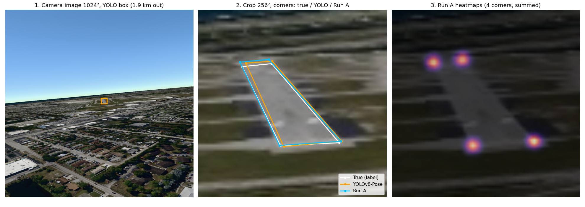

# Detecting aircraft position from runway corners (LARD V2)

VIZA 669 (Intro to Deep Learning for VCIM, Texas A&M, Fall 2026) course project by Nisarg Sonar.

From a single camera frame of a landing approach, a neural network finds the runway's 4 corners; geometry (PnP)
then turns those 4 pixels into the aircraft's position, and from that the three numbers a pilot needs:
**distance to the threshold, lateral angle, glide angle**. Trained and tested on the synthetic
[LARD V2](https://huggingface.co/datasets/DEEL-AI/LARD_V2) dataset; test airports are never seen in training.

## Pipeline

```
camera image (1024²) → YOLO runway box → crop 1.6× the box, resize to 256²
   → backbone (ResNet-50 or DINOv2) → one 64×64 heatmap per corner → soft-argmax (sub-pixel corner)
   → PnP with the runway's real size → distance, lateral angle, glide angle
```

**The one change versus the released YOLOv8-Pose baseline:** YOLO reads the corners as numbers from the full
image, where the runway is often ~20 px. This project zooms into the runway first and predicts a heatmap per
corner, so a corner can land between pixels. The runway box and the geometry are the same for both.



A screen recording of the demo is in `Recording of pipeline.mp4`.

## Results (Bing Maps test set, 1,086 runways at unseen airports, medians)

Every model is scored on the same runways with the same detector boxes.

| Model | Corner error | ≤ 1 px | Position error |
|---|---|---|---|
| YOLOv8-Pose (released by the LARD authors) | 1.39 px | 25% | 309 m |
| ResNet-50, Bing subset (4,599 crops) | 1.13 px | 38% | 326 m |
| DINOv2 ViT-S/14, same data | 1.12 px | 40% | 334 m |
| **Run A**: ResNet-50, Bing + X-Plane (15,925 crops) | **1.06 px** | **44%** | **289 m** |

Paired bootstrap (2,000 resamples, 95% CI):
- **Corners, Run A vs YOLO:** −0.33 px (−0.37 to −0.28), significant; closer on 72% of runways.
- **Position, Run A vs YOLO:** −20 m (−62 to +12), a tie.
- **More data helped:** Run A vs the Bing-only ResNet-50, −37 m position (−63 to −8).
- **CNN vs ViT:** tied on Bing. On Microsoft Flight Simulator (n = 1,088), which no model was trained on,
  DINOv2 beats ResNet-50 by 63 m position (−95 to −34).
- **Two runways in view** (joint PnP on all 8 corners, n = 92 images): 421 m → 46 m. The wrong-runway check
  picks the lined-up runway correctly in 95.7–96.7% of these images.
- **Edge keypoints** (16-point PnP): no gain, +2 m (−15 to +25, n = 1,080).

**What fails, and why:**
- **Distance, not direction:** 287 m of the 289 m median position error lies along the runway. Lateral and glide
  errors are 0.13° and 0.21°.
- **Tiny far runways:** a ~1 px shift changes the runway's apparent length, which PnP reads as distance. Even the
  true labels (whole pixels) give 198 m beyond 4.5 km vs 13 m under 2.5 km.
- **Look-alike pavement:** rare gross misses where the network locks onto nearby paving; 6.1% of runways have
  more than 3 px corner error, vs 9.1% for YOLO.

All numbers, with their n, are in [`results/MORNING_REPORT.md`](results/MORNING_REPORT.md) and `results/results.json`.
Failure examples: [`report/figs/fig5_failure_cases.png`](report/figs/fig5_failure_cases.png).

## Layout
| Path | What it is |
|---|---|
| `lard_geom.py` | Geometry: runway databases, label loader, IPPE PnP with physical constraints, guidance angles and errors |
| `corners/` | The corner model: `data.py` (crops, augmentation, 16-keypoint labels), `model.py` (ResNet-50 / DINOv2 + heatmap head, soft-argmax), `train.py`, `evaluate2.py`, `summarize.py`, `val_breakdown.py` |
| `baselines/eval_yolov8pose.py` | Scores the released YOLOv8-Pose predictions on the full test set (n = 47,191 runways: 1.38 px, 308 m) |
| `improvements/multirunway2.py` | Joint two-runway PnP and the wrong-runway check |
| `demo/` | `demo_one.py` (one test image through every model, prints distance/angles, saves a figure), `show_label.py` |
| `data/` | Download scripts and the airport-level train/val/test splits |
| `runs/` | Training histories, logs and per-runway evaluation CSVs for the three models |
| `results/` | `results.json`, `MORNING_REPORT.md`, multi-runway results |
| `report/` | Figure scripts, figures, and a results web page |

## Not included in this repository
- **Dataset images and metadata:** download LARD V2 from [Hugging Face](https://huggingface.co/datasets/DEEL-AI/LARD_V2).
  The per-renderer metadata CSVs go in `data/` as `m_<renderer>_<split>.csv`; `data/download_subset.py` and
  `data/download_more.py` fetch the images used here.
- **Runway databases:** clone [deel-ai/LARD](https://github.com/deel-ai/LARD) next to this folder (`../LARD/data/runways_db_V2_*.json`).
- **YOLOv8-Pose predictions:** `yolov8pose_IN_ODD_predictions.json` from
  [deel-ai-papers/Yolo_models_LARD_V2](https://github.com/deel-ai-papers/Yolo_models_LARD_V2) (AGPL-3.0), placed in `baselines/`.
- **Trained checkpoints** (93–389 MB each, over GitHub's file limit).

## Run
```bash
python3 data/download_subset.py && python3 data/download_more.py
python3 baselines/eval_yolov8pose.py
python3 -m corners.train --epochs 10                                         # ResNet-50, Bing subset
python3 -m corners.train --backbone dinov2_vits14 --out dinov2_bing --epochs 10
python3 -m corners.train --n-kp 16 --data bing_xplane --out runA --epochs 10  # Run A
python3 -m corners.evaluate2 --run runA --test bing_all                      # also: --test flsim, bing662
python3 improvements/multirunway2.py --run runA --test bing_all
python3 -m corners.summarize && python3 report/morning_report.py
python3 demo/demo_one.py --pick near                                         # needs the checkpoints
```
Trained on an Apple M4 laptop (PyTorch, MPS): ~4–5 min per epoch for 4,599 crops, ~14 min for Run A's 15,925.

**DINOv2 on Python 3.9:** the `facebookresearch/dinov2` hub code uses `float | None` annotations (Python ≥ 3.10).
Here the cached copy in `~/.cache/torch/hub/facebookresearch_dinov2_main` was patched with
`from __future__ import annotations` (annotation-only change). Python ≥ 3.10 needs no patch.

## Dataset quirks handled in `lard_geom.load_labels`
- Runway names must be read as strings (`05`, not `5`), or ~7% of labels miss the runway database.
- The Google Earth and X-Plane CSVs have no `lat/lon/alt`. All renderers share the same scenario poses, so those
  are filled from the ArcGIS / Bing / Flight Simulator CSVs.
- ~7% of test labels reference runways absent from that renderer's runway database; they are skipped.

## Notes
- Training crops use the true box with random jitter as a detector stand-in; test crops use the released
  detector's boxes, so every model, YOLO included, starts from identical detections.
- The released YOLO training config uses the LARD test images as its validation set, so its numbers may be
  slightly optimistic. This project's validation set is 10 held-out training airports.
- LARD V2 is synthetic and daytime only; real flight footage has not been tested.
